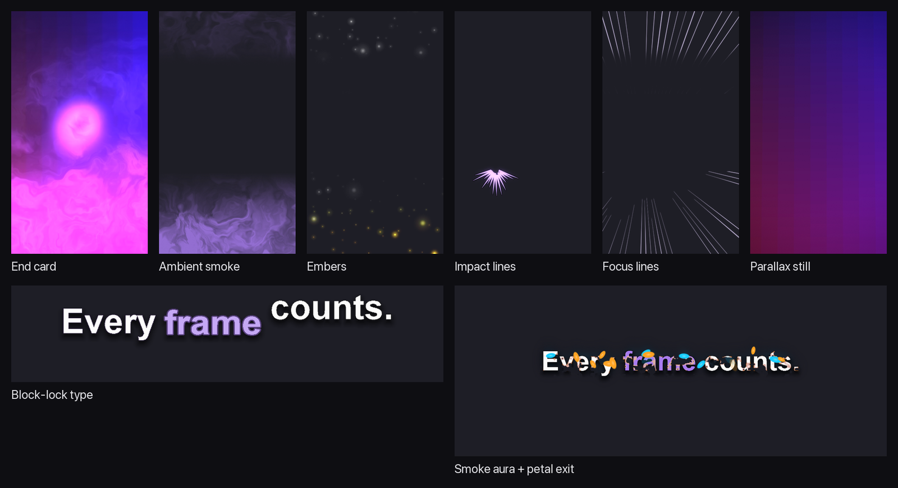

# Effects

Reelly's motion design runs on one small platform: GLSL fragment shaders,
rendered frame by frame in headless Chrome through WebGL, read back and
composited with ffmpeg. Every effect is data plus a shader, every brand picks
from the same presets, and every frame is deterministic: frame `n` is exactly
time `n / fps`, never wall-clock time.

```
effect file (.glsl)  ->  preset (.json)  ->  brand kit (brand.json "effects")
   what it draws          tuned values          which presets play where
                                 ^
                    content type: what suits this footage
                    control track: what happened in this cut
```

## Placements and presets

| Placement | Preset | What it draws | Tunable parameters |
|---|---|---|---|
| `endcard` | `smoke` | smoke rising through the end card, an ink-blot transition from the last frame, a ring of light when the call to action's hot word pops | `u_trans` (transition length, s) |
| `ambient` | `smoke` | a smoke veil in the space around the picture, swelling on pops, building into the end | `u_level` (0 to 1.5) |
| `ambient` | `embers` | embers rising in three depth layers, flaring on beats, sharp sounds and pops, denser when the audio is loud; with bloom | `u_density`, `u_speed`, `u_size`, `u_react`, `u_core` (colour) |
| `ambient` | `impact` | comic impact lines from the picture's edge exactly where a real impact happens | `u_size`, `u_hold`, `u_bite`, `u_min_s`, `u_ink` (colour) |
| `ambient` | `focus` | manga focus lines converging on the biggest impacts only | `u_count`, `u_hold`, `u_min_s`, `u_opacity`, `u_line` (colour) |
| `text` | `smoke` | dark smoky wisps off kinetic text and an accent flare on the hot word's pop | `u_ink` (colour) |
| `finish` | `folk-print` | experimental: the space around the picture reduced to a three-colour print (surface, accent, ink) with dither, halftone and grain | `u_mix`, `u_dot`, `u_grain` |
| `still` | `parallax` | `reelly parallax`: a 2.5D push-in or dolly on a still from its depth map | `u_push`, `u_depthk`, `u_dolly`, `u_focus`, `u_center`, `u_fit` |

See them before you pick:

```sh
reelly fx list                                   # every preset and its parameters
reelly fx preview embers --brand mybrand         # fx-ambient-embers.mp4, in your colours
reelly fx preview embers --set u_density=0.6     # try a value without editing brand.json
```

A preview plays the preset over a stand-in cut (a 16:9 panel with a blurred
fill around it) with a scripted control track: a beat every half second, two
hot-word pops and two impacts, so reactive effects show how they react.

Colour inputs marked with a brand slot (`accent`, `ink`, `surface`) take the
brand's colours automatically. Tune a preset per brand:

```json
"effects": {"ambient": ["smoke", {"preset": "embers", "params": {"u_density": 0.5}}]}
```

Ambient and finish layers never touch the content: they draw only in the space
around the picture and keep clear of the text band. On a split facecam cut the
camera and the screen are protected together; a crop that follows faces fills
the frame, so it gets no ambient layer at all.

Override any placement for one run with `REELLY_FX_<PLACEMENT>`, for example
`REELLY_FX_AMBIENT=smoke,embers` or `REELLY_FX_ENDCARD=off`. `REELLY_FX_LITE=1`
renders every preset's lighter variant.

## Content types

`reelly/effects/content_types/` says what suits each kind of footage.

| Content type | Ambient presets | Faces protected | Impacts drive marks |
|---|---|---|---|
| `gameplay` (default) | all | no | yes |
| `talking-head` | `smoke`, `embers` | yes | no |
| `podcast` | `smoke` | yes | no |
| `screen-demo` | `smoke` | no | no |

Reelly guesses: a crop that follows faces is `talking-head`, everything else
(including gameplay with a facecam) is `gameplay`. Set it with the brand's
`video.content_type` or `REELLY_CONTENT_TYPE`. Text behind the subject is only
ever allowed where faces are protected.

## The control track

Every cut gets one control track, and every effect can read it:

- **beats**: the music's beat grid (from the track's stated tempo, else detected);
- **pops**: when each hot word pops, so effects answer the type;
- **onsets**: the cut's sharpest sounds;
- **energy**: loudness per frame, 0 to 1;
- **events**: real impacts, where the sound and the picture jump together.
  When the Codex CLI is signed in, each candidate is shown to a vision model,
  which confirms it and names where it happened; without that check there are
  no impact marks (unverified candidates landed on effects like meteor trails).

In GLSL, `#include "lib/control.glsl"` gives:

```glsl
float beatPhase(float t);            // 0..1 through the current beat
float beatPulse(float t, float k);   // 1 on each beat, decaying (k = sharpness)
float energy(float t);               // loudness at t, 0..1
float sinceOnset(float t);           // seconds since the latest sharp sound
// u_events[8]: vec4(t, x, y, strength), x/y in picture uv; t < 0 = unused
```

## Writing an effect

An effect is one `.glsl` file in `reelly/effects/` with a JSON header in its
first comment. The header format is inspired by ISF but is not ISF-compatible.

```glsl
/*{
  "VSN": "1.0", "LICENSE": "MIT",
  "DESCRIPTION": "Soft accent glow that breathes with the music.",
  "REELLY": {"kind": "overlay"},
  "INPUTS": [
    {"NAME": "u_accent", "TYPE": "color", "DEFAULT": [0.66, 0.49, 0.94], "SLOT": "accent"},
    {"NAME": "u_level", "TYPE": "float", "DEFAULT": 0.5, "MIN": 0.0, "MAX": 1.0},
    {"NAME": "u_pic", "TYPE": "vec4", "DEFAULT": [0, 0, 0, 0], "HOST": true}
  ]
}*/
#include "lib/control.glsl"
#include "lib/finish.glsl"
void main(){
  vec2 uv = gl_FragCoord.xy / u_res;
  bool inPic = uv.x >= u_pic.x && uv.y >= u_pic.y && uv.x <= u_pic.z && uv.y <= u_pic.w;
  float a = inPic ? 0.0 : u_level * (0.4 + 0.6 * beatPulse(u_t, 6.0));
  gl_FragColor = vec4(dither(u_accent, gl_FragCoord.xy) * a, ditherA(a, gl_FragCoord.xy));
}
```

- **kind**: `backdrop` (paints the whole frame over `u_bg`), `overlay` (a
  transparent layer), `text` (reads a kinetic text frame `u_txt` and its blur
  `u_blur`) or `filter` (reads the cut's own frames).
- **INPUTS**: `TYPE` is `float`, `color`, `vec2`, `vec3`, `vec4` or `float[8]`.
  `MIN`/`MAX` clamp every value; `SLOT` binds a brand colour; `HOST: true`
  marks values Reelly fills per frame (a brand cannot set them). An unknown
  parameter name is refused, never ignored.
- **Always provided**: `u_res`, `u_t` (seconds), `u_t0`, the control track
  (`u_beat`, `u_onsets`, `u_ctrl`, `u_ctrl_n`, `u_ctrl_rate`, `u_events`) and the
  kind's textures. Do not declare them.
- **Libraries** (`#include "lib/..."`, only from `effects/lib`): `noise.glsl`
  (`hash`, `noise`, `fbm`, `smoke`), `control.glsl`, `transition.glsl`
  (`inkWipe`), `finish.glsl` (`dither`, `ditherA`).
- **Deterministic**: draw from `u_t` only, keep no state between frames, and
  hash without `sin` (the library's `hash` gives the same value on every GPU).

Then add a preset, `reelly/effects/presets/<placement>/<name>.json`:

```json
{
  "version": 1,
  "effect": "my_glow",
  "description": "A soft accent glow around the picture that breathes on the beat.",
  "params": {"u_level": 0.4},
  "render": {"scale": 0.5, "fps": 30, "bloom": {"threshold": 0.4, "strength": 1.0, "sigma": 14}},
  "lite": {"render": {"scale": 0.25, "fps": 30, "bloom": null}}
}
```

`render` options: `scale` (of 1080x1920), `fps`, `bloom`, `sparse: "events"`
(render only around real impacts; every other frame is blank), and for text
effects `blur_px` and `text_off` (the margin around the text). Brands can now
use it as `"ambient": ["my_glow"]`, and `reelly brand check` knows it.

## GPU tiers

Effects render on the hardware GPU through Chrome's ANGLE layer: Direct3D 11
on Windows (the high-performance adapter), Metal on macOS, OpenGL on Linux.
Without a usable GPU, `REELLY_GPU=auto` falls back to SwiftShader, the software
renderer, for the rest of the run; `REELLY_GPU=gpu` fails instead. The
renderer in use is logged once per run.

## Golden frames



Every effect is rendered at fixed instants from fixed inputs and compared with
stored reference images, so a change that alters how an effect looks fails a
test instead of shipping quietly. References are kept per renderer tier
(`tests/golden/<tier>/`) because GPUs agree closely but not bit for bit.

```sh
uv run python -m reelly.golden             # compare on this machine
uv run python -m reelly.golden --update    # (re)write this tier's references
```

A tier without references is skipped, unless `REELLY_GOLDEN=required` (set it
on CI and render machines, so a GPU that silently fell back fails). A case
missing from a tier that has references always fails.

## Safety

Every deliverable goes through the photosensitivity gates whatever made a
flash: Reelly's own WCAG 2.3.1 check (general flashes, more than three per
second in any region fails) and, where installed, EA IRIS (luminance and red
flashes, the extended rule, harmful patterns). A file the check cannot read
fails. IRIS is a detector, not a certification.
